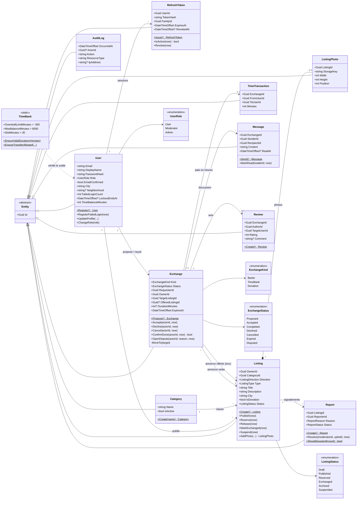
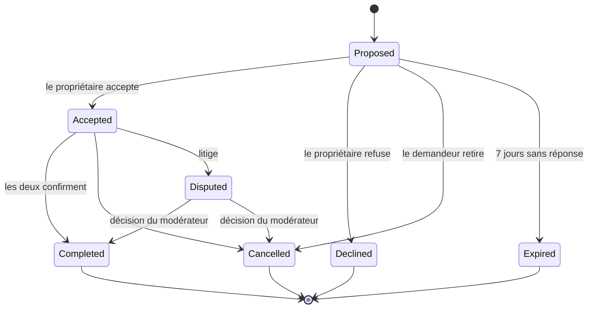

# Diagramme de classes de TradX

Ce diagramme montre les classes du **domaine** (projet `TradX.Domain`) : les objets métier et leurs règles.
Chaque classe devient une table dans PostgreSQL (voir `AppDbContext.cs`).

Les liens entre classes sont des **identifiants** (`OwnerId`, `CategoryId`…), pas des objets imbriqués.
Chaque module reste ainsi indépendant, et l'on charge seulement ce dont on a besoin.

## Lecture rapide

| Classe | Rôle |
|---|---|
| `Entity` | Classe mère : donne à chaque objet un identifiant unique (`Guid`). |
| `User` | Un membre : e-mail, mot de passe **haché**, rôle, solde d'heures. |
| `RefreshToken` | Une session de connexion, stockée hachée et révocable. |
| `Category` / `Listing` / `ListingPhoto` | Une annonce (« je propose » ou « je cherche »), sa catégorie et ses photos. |
| `Exchange` | Un échange entre deux membres : troc, banque de temps ou don. Il suit une **machine à états**. |
| `TimeTransaction` / `TimeBank` | Les mouvements d'heures (1 h de service = 1 h de crédit) et leurs limites. |
| `Message` / `Review` / `Report` | La discussion d'un échange, les avis et les signalements. |
| `AuditLog` | Le journal des actions sensibles (qui, quoi, quand, depuis quelle IP). |

## Cycle de vie d'un échange

Ces transitions sont définies à un seul endroit : `AllowedTransitions` dans
`src/TradX.Domain/Exchanges/Exchange.cs` (ligne 64). Toute autre transition est refusée par `MoveTo` (ligne 322).
